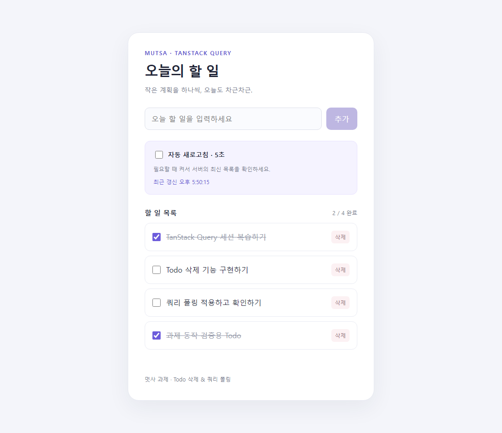
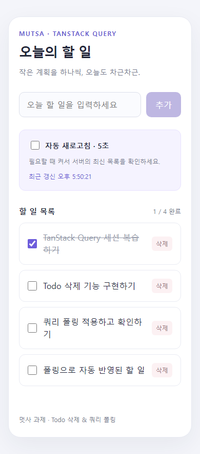

# 멋사 과제(TanStack Query Todo)_2026-11-15

React + TypeScript + TanStack Query로 구현한 Todo List입니다. 세션 프로젝트에 API 연동, 삭제 기능, 새로운 학습 주제인 **쿼리 폴링(Polling)**을 적용했습니다.

## 실행 방법

Node.js 22.12 이상 권장.

```bash
npm ci
npm start
```

- 터미널에 표시되는 Vite 주소로 접속합니다. 기본값은 http://127.0.0.1:5173 이며, 사용 중이면 다음 포트를 사용합니다.
- API: http://localhost:3000/todos
- 프런트엔드와 API를 함께 실행하며 Ctrl+C로 종료합니다.
- 별도 실행: `npm run dev`, `npm run server`
- 테스트 전용 프런트엔드는 5174 포트를 사용합니다.

## 과제 1. Todo 삭제

1. `src/api/todo.ts`의 `deleteTodo(id)`에서 `DELETE /todos/{id}`를 호출합니다.
2. 응답의 `ok`를 확인한 뒤 성공한 ID를 반환합니다. 응답 본문이 없는 경우에도 동작하도록 JSON을 읽지 않습니다.
3. `src/hooks/useTodos.ts`에서 `useMutation({ mutationFn: deleteTodo })`로 요청을 관리합니다.
4. 성공하면 `cancelQueries`로 진행 중인 목록 조회를 취소하고, `setQueryData<Todo[]>`와 `filter(todo => todo.id !== deletedId)`로 해당 항목을 캐시에서 제거합니다.
5. 삭제 Mutation에서는 `invalidateQueries`나 `refetch`를 호출하지 않습니다. 실패하면 기존 목록을 유지하고 오류를 표시합니다.

추가·수정·삭제 중에는 모든 변경 버튼과 입력을 비활성화하여, 낙관적 업데이트의 목록 백업과 다른 변경이 충돌하지 않게 했습니다. 목록 조회는 AbortSignal을 fetch에 전달하여 실제 요청 취소를 지원합니다. 완료 상태 변경에는 세션에서 배운 낙관적 업데이트 및 실패 시 롤백을 적용했습니다.

### 삭제 전 / 삭제 후

실제 앱을 실행하여 촬영한 화면입니다.




## 과제 2. 새로 학습한 기능: 쿼리 폴링

**폴링**은 일정 시간마다 서버를 조회하여 최신 데이터를 반영하는 기능입니다. 다른 창이나 API 클라이언트에서 변경한 Todo도 화면을 새로고침하지 않고 가져올 때 사용합니다.

`src/App.tsx`에 다음 설정을 적용했습니다.

```tsx
const busy = useIsMutating({ mutationKey: todoMutationKey }) > 0;

useQuery({
  queryKey: todosKey,
  queryFn: fetchTodos,
  refetchInterval: polling && !busy ? 5000 : false,
  refetchIntervalInBackground: false,
  refetchOnWindowFocus: false,
  retry: 1,
});
```

- **자동 새로고침 · 5초**를 켜면 5초마다 목록 GET 요청이 발생합니다.
- 기본값은 꺼짐입니다. 삭제의 캐시 갱신과 주기적 GET 요청을 각각 확인할 수 있습니다.
- 변경 요청 처리 중에는 폴링을 일시 정지합니다.
- 백그라운드 탭에서는 주기적 요청을 쉬도록 설정했습니다.
- 창에 다시 포커스할 때의 자동 조회는 꺼서 삭제 결과를 확인할 때 불필요한 GET을 방지했습니다.
- 최근 캐시 갱신 시각과 조회 중 상태를 화면에 표시합니다.
- 폴링은 주기적 GET을 사용하므로 서버 부하와 데이터 신선도에 맞게 간격을 정해야 합니다. 실시간 푸시 기능은 아닙니다.

### 폴링 확인 방법

1. 앱에서 자동 새로고침을 켭니다.
2. 다른 터미널에서 아래 명령을 실행합니다.
3. 5초 내에 새 Todo가 앱에 나타나는지 확인합니다.

```powershell
Invoke-RestMethod -Uri 'http://localhost:3000/todos' -Method Post -ContentType 'application/json' -Body '{"title":"Polling test","completed":false}'
```




참고: [TanStack Query 공식 폴링 문서](https://tanstack.com/query/latest/docs/framework/react/guides/polling), [공식 포커스 재조회 문서](https://tanstack.com/query/latest/docs/framework/react/guides/window-focus-refetching)

## 검증

```bash
npm run build
npm run lint
npx playwright install chromium
npm test
```

실제 json-server와 Chromium으로 다음 동작을 검증했습니다.

- Todo 추가 및 완료 변경
- 완료 변경 실패 시 낙관적 업데이트 롤백
- 삭제 실패 시 목록 유지 및 오류 표시
- 성공한 삭제에서 DELETE 1회, 후속 GET 0회 확인 (폴링 꺼짐)
- 삭제된 ID가 `server/db.json`에서도 사라졌는지 확인
- 페이지 새로고침 후에도 삭제 결과 유지
- 외부 API로 생성한 Todo가 폴링으로 자동 반영
- 폴링을 끈 뒤에는 주기적 GET이 발생하지 않음
- 모바일 너비 390px에서 가로 넘침 없음

테스트는 검증용 Todo를 생성하고 마지막에 정리합니다. 스크린샷은 테스트 중 `docs/screenshots/`에 저장합니다. 테스트 데이터가 다른 사용자 작업과 겹치지 않도록 개발 서버에서 실행하세요.

## 프로젝트 구조

- `src/api/todo.ts`: GET / POST / PATCH / DELETE API
- `src/hooks/useTodos.ts`: Mutation, 캐시 갱신, 낙관적 업데이트
- `src/App.tsx`: 목록 Query, 폴링 설정, 요청 상태 표시
- `src/components/`: 입력 폼과 Todo 목록
- `server/db.json`: JSON Server 데이터
- `tests/todos.spec.ts`: 실제 API를 사용하는 브라우저 통합 테스트

## 원본 및 제출

- 세션 기본 프로젝트: [siyeonlim0128-netizen/tanstack-query-session](https://github.com/siyeonlim0128-netizen/tanstack-query-session)
- 저장소 이름은 GitHub의 문자 제한에 맞춰 영문으로 표기했습니다.
- 노션 과제 제출 페이지에 이 저장소 링크를 제출하면 됩니다.

