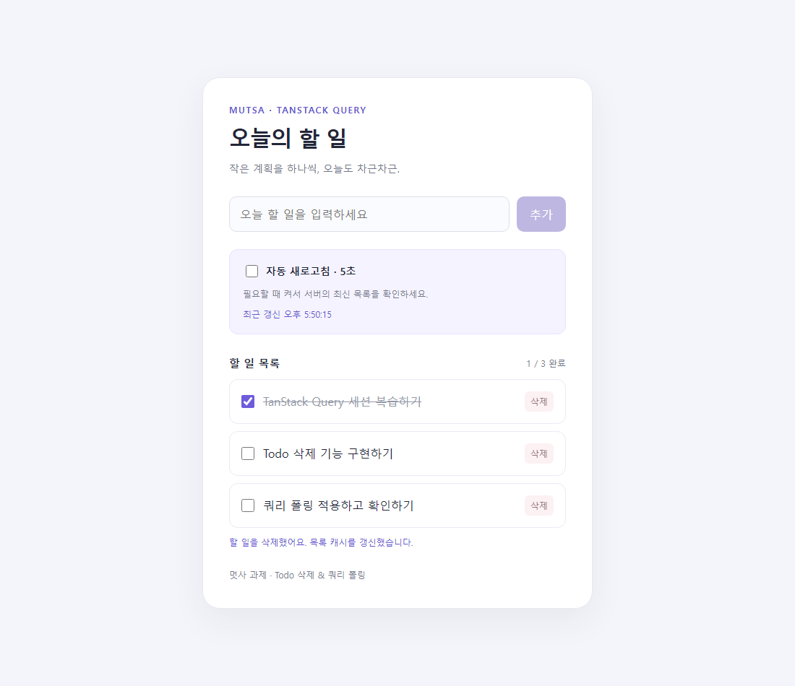

구현한 코드 

### 쿼리 폴링 — `src/App.tsx`

```tsx
const busy = useIsMutating({ mutationKey: todoMutationKey }) > 0;

const query = useQuery({
  queryKey: todosKey,
  queryFn: fetchTodos,
  refetchInterval: polling && !busy ? 5000 : false,
  refetchIntervalInBackground: false,
  refetchOnWindowFocus: false,
  retry: 1,
});
```


### Todo 삭제 — `src/api/todo.ts`, `src/hooks/useTodos.ts`

`deleteTodo(id)`는 `DELETE /todos/{id}` 요청을 보내고, 성공하면 삭제한 ID를 반환합니다. `useMutation`으로 삭제 요청과 오류 상태를 관리합니다.

```tsx
const remove = useMutation({
  mutationKey: todoMutationKey,
  mutationFn: deleteTodo,
  onSuccess: async (deletedId) => {
    await client.cancelQueries({ queryKey: todosKey });
    client.setQueryData<Todo[]>(todosKey, (current) =>
      current?.filter((todo) => todo.id !== deletedId));
  },
});
```


화면 스크린샷

### 삭제 전

검증용 Todo가 목록에 표시된 화면입니다.


### 삭제 후

삭제한 Todo가 사라지고 캐시 갱신 안내가 표시된 화면입니다.




