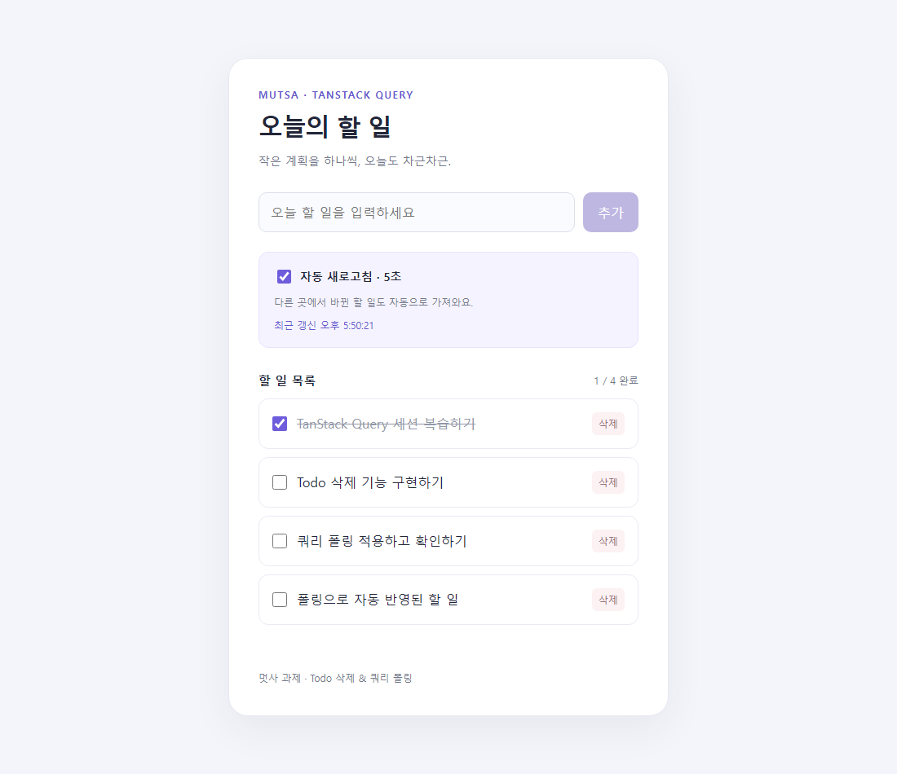

## 1. 선택한 TanStack Query 기능과 간단한 설명

**쿼리 폴링(Polling)**을 적용했습니다. 일정 시간마다 서버 데이터를 다시 조회하는 기능으로, 다른 창이나 API에서 변경한 Todo를 페이지 새로고침 없이 반영할 수 있습니다.

화면에서 **자동 새로고침 · 5초**를 켜면 5초마다 최신 목록을 가져오며, 끄면 주기적 조회가 중단됩니다.

## 2. 구현한 코드 설명

### 쿼리 폴링 — `src/App.tsx`

```tsx
const busy = useIsMutating({ mutationKey: todoMutationKey }) > 0;

const query = useQuery({
  queryKey: todosKey,
  queryFn: fetchTodos,
  refetchInterval: polling && !busy ? 5000 : false,
  refetchIntervalInBackground: false,
  refetchOnWindowFocus: false,
  retry: 1,
});
```

- `refetchInterval`: 자동 새로고침이 켜져 있고 변경 요청이 없을 때 5초마다 조회합니다. 그 외에는 `false`로 중단합니다.
- `useIsMutating`: 추가·수정·삭제 처리 중에는 폴링을 일시 정지해 캐시 변경과 충돌하지 않게 합니다.
- `refetchIntervalInBackground: false`: 백그라운드 탭에서는 주기적 조회를 쉽니다.
- `refetchOnWindowFocus: false`: 창에 다시 포커스할 때 발생하는 자동 조회를 끕니다.
- `dataUpdatedAt`과 `isFetching`으로 최근 갱신 시각과 조회 중 상태를 표시합니다.

### Todo 삭제 — `src/api/todo.ts`, `src/hooks/useTodos.ts`

`deleteTodo(id)`는 `DELETE /todos/{id}` 요청을 보내고, 성공하면 삭제한 ID를 반환합니다. `useMutation`으로 삭제 요청과 오류 상태를 관리합니다.

```tsx
const remove = useMutation({
  mutationKey: todoMutationKey,
  mutationFn: deleteTodo,
  onSuccess: async (deletedId) => {
    await client.cancelQueries({ queryKey: todosKey });
    client.setQueryData<Todo[]>(todosKey, (current) =>
      current?.filter((todo) => todo.id !== deletedId));
  },
});
```

진행 중인 조회를 취소한 뒤 `setQueryData`로 삭제한 Todo를 캐시에서 제거합니다. 삭제 성공 후 `invalidateQueries`나 추가 GET 요청 없이 화면에 반영하며, 실패하면 기존 목록을 유지하고 오류를 표시합니다.

완료 상태 변경에는 `onMutate`에서 캐시를 먼저 수정하는 낙관적 업데이트를 적용했습니다. 요청이 실패하면 `onError`에서 백업한 목록으로 복구하고, `onSettled`에서 서버 데이터와 다시 동기화합니다.

## 3. 기능이 실제로 동작하는 화면 스크린샷

### 삭제 전

검증용 Todo가 목록에 표시된 화면입니다.


### 삭제 후

삭제한 Todo가 사라지고 캐시 갱신 안내가 표시된 화면입니다.


### 쿼리 폴링

자동 새로고침을 켠 상태에서 외부 API로 추가한 할 일이 화면에 자동 반영된 모습입니다.


